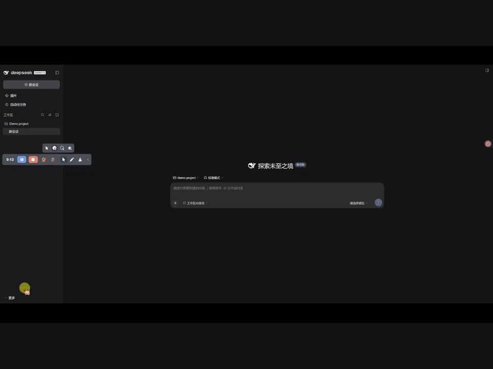
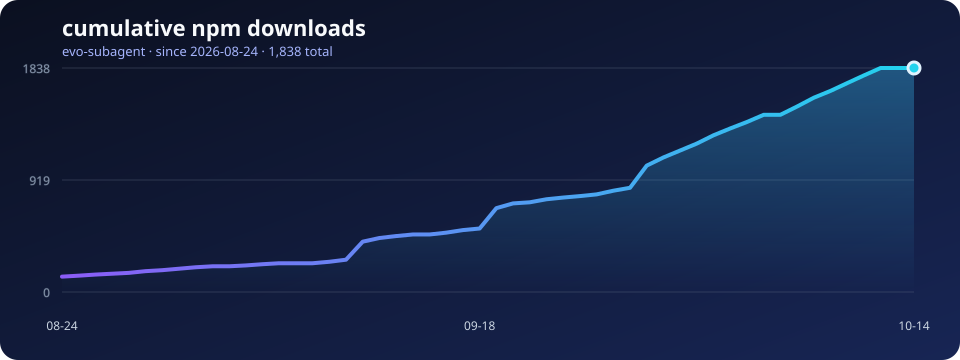

# evo-subagent

[English](README.md) | [简体中文](README.zh-CN.md)


[](https://www.npmjs.com/package/evo-subagent)
[](LICENSE)

**不同工作区，不同人格；让风格适应你的项目与对话。**

**跨工作区风格适应 · 独立人格分配 · 对话内即时切换**

evo-subagent 1.1 让你的 DeepSeek Harness 助手在不同项目中保持合适的相处方式：开发工作区高效直接，讨论工作区保留独立判断，日常对话温和陪伴。共享一份熟悉的风格，或为每个工作区、每段对话单独分配人格，都由你决定。独立档案中的风格学习留在本范围内，不回写全局人格。

## 可以做什么

| 功能 | 用途 |
| --- | --- |
| 工作区人格 | 分别设置人格名称、预设和风格要求，为不同项目分配不同搭档。 |
| 对话独立 | 在输入框旁选择独立人格，当前对话可以保留自己的风格与学习。 |
| 自适应风格 | 喜欢简洁、轻松还是细致？根据你的明确反馈，逐渐调整语气、详略和互动方式。 |
| 陪伴人格 | 温和陪伴、理性沉稳、轻松幽默、直接利落、细致引导，选一种舒服的相处方式。 |
| 自主风格学习 | 在后台整理对话反馈、复盘表达风格，让相处方式逐步成长。 |
| 偏好记忆 | 把你确认的交流偏好留下，跨对话复用，也能为不同项目分别维护。 |
| 角色协作 | 聊天时是搭子，做事时能分工：为不同角色选择模型，积累可复用的任务经验。 |

## 安装

```sh
dsh plugin add evo-subagent
```

需要 DeepSeek Harness `^0.2.1-rc.2` 和 Node.js `>=24.2.0`。

## 开始使用

打开 DSH 的**插件设置**，进入 **evo-subagent**。页面分为三个栏目，按需要开启即可。

### 为工作区分配人格

在**陪伴人格 → 工作区人格**中选择项目，勾选**为这个工作区单独维护人格**，然后设置人格名称、预设和风格要求。例如：“开发搭档：高效直接，先给方案；保留独立判断。”

保存后的设置在后续回复中即时生效。每个工作区独立保存自己的调整与学习，不参与全局人格优化。

### 创建或切换独立对话

在对话输入框旁打开**人格**，选择**工作区独立**或**仅此对话独立**，即可单独调整预设、风格要求与学习开关。新建对话时就能选择，已有对话也能随时切换。新建独立档案默认关闭后台学习，需要时再主动开启。

### 陪伴人格

先选择适用范围，必要时再选择要配置的工作区或对话。开启**陪伴人格**后，可以选择：

- **陪伴人格模式（固定预设）：** 选定温和、理性、幽默、利落或细致的风格，让日常交流保持熟悉的基调。
- **自适应风格模式（自主探索）：** 从预设出发，尝试小幅风格变化，再根据你的明确反馈逐渐调整。

想让风格自己慢慢长出来？选择**自主探索**并开启**逐渐了解我**，即可使用**自主风格学习**：助手在后台整理对话反馈、定期复盘，并逐步调整表达方式。你可以这样给它方向：

> 平时和我说话轻松一点；写代码时直接给结论；聊烦恼时先听我说，再给建议。

新的长期记忆仍由你确认；暂停了解、忘记偏好或恢复上次风格，都由你决定。

### 用户习惯

开启**用户习惯**，用一小段话描述你的偏好，例如：

> 默认用中文，先给结论，日常回答简洁一些；需要时说明依据。

新的建议会合成一份更新供你修改和确认，确认后的偏好才会生效。

### 子代理管理

选择工作区，添加内置角色或使用自己的角色文件，再为不同角色选择已注册的模型。开启经验积累后，子代理可以在后续任务中复用已验证的命令与经验。

支持路由 **DSH 中任意已注册的模型**，包括通过其他 provider 插件接入的 **Codex、Claude Code** 等模型。先完成对应插件的模型配置，再到这里选择即可。

## 选择共享范围

人格与用户习惯可以**分别选择适用范围**。例如，所有项目共享一份交流偏好，同时为每个项目设置不同人格。

| 范围 | 效果 |
| --- | --- |
| 所有工作区共享 | 所有工作区、对话共用一份档案。 |
| 每个工作区独立 | 同一工作区内跨对话共享，不同项目相互独立。 |
| 每个对话独立 | 每个工作区中的每个对话分别维护。 |

切换范围会保留已有档案。可以保留共享默认设置，只让指定工作区或对话独立。要配置旧对话，先在 DSH 中打开它，再刷新列表。

## 数据与控制

档案保存在本机 DSH 用户目录。开启人格学习时，少量对话摘录会发送给所选模型进行后台整理，并产生额外模型用量。新的长期记忆由你确认，也可以随时暂停或关闭学习。

升级后，原有模型路由、项目经验与人格档案继续保留。

## 1.1 更新了什么

- 新增工作区人格名称、风格要求与独立分配。
- 在对话输入框旁新增人格选择，支持当前对话独立学习。
- 支持关联刷 B 站插件，将视频笔记保存在指定工作区，供后续任务参考。

[完整更新日志](CHANGELOG.md) · [版本发布说明](https://github.com/ZekaiShi/evo-subagent/releases)

## 操作演示



[观看子代理管理视频](assets/evo-subagent-tutorial.mp4)。此演示介绍角色配置；陪伴人格与用户习惯为 1.0 新增内容。

## 附加玩法：让大肥鱼留下读过的内容

使用[刷 B 站插件](https://github.com/c1overzz/dsh-bili-scroll)时，先配置它并保留日报；然后在某个独立工作区的人格设置中，展开**附加：B 站内容学习**，点击**关联到此工作区**。

它读过的视频笔记会存入该工作区的内容记忆，并随人格一起用于后续刷 B 站任务。视频内容作为资料参考，不作为用户偏好或人格价值观。可手动同步、清除内容记忆或断开关联；评论和私信设置仍由刷 B 站插件控制。

## 下载趋势



图表展示 npm 累积下载量，每天更新；下载次数不等于独立用户数。

[反馈问题](https://github.com/ZekaiShi/evo-subagent/issues) · [MIT 许可证](LICENSE)
